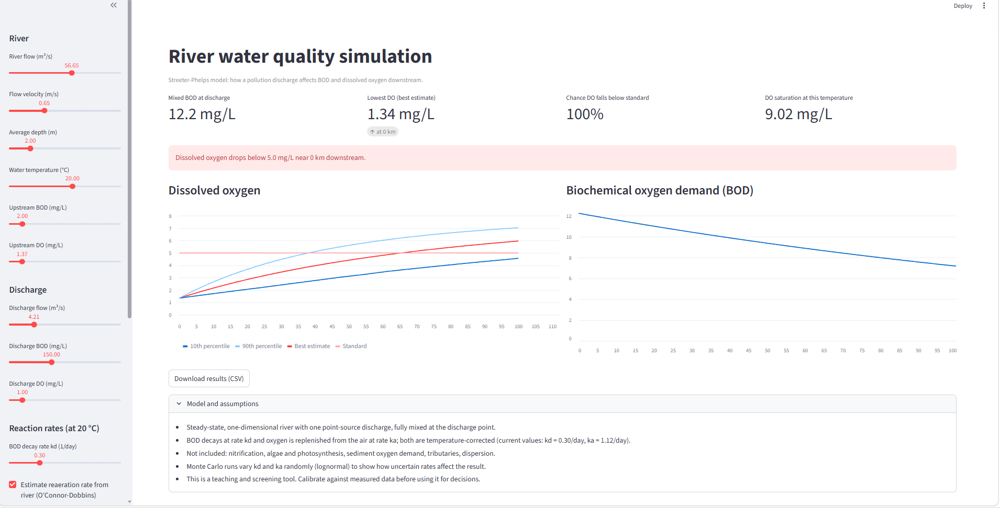

# Simulation of the Effect of Pollution Discharge on River Water Quality 

An interactive Streamlit app that simulates how a pollution discharge affects river water quality, using the Streeter-Phelps oxygen sag model.

**Live demo:** https://t4cttpktwec3sbg5xg8gj2.streamlit.app/




## What it does

- Mixes the river with a discharge (for example, treated or untreated wastewater) and tracks organic pollution (BOD) and dissolved oxygen (DO) downstream.
- Shows the oxygen sag: the stretch where bacteria break down the pollution faster than the river can replace the oxygen.
- Reports the lowest oxygen level, where it occurs, and whether it falls below a chosen standard (default 5 mg/L).
- Runs Monte Carlo simulations with varied decay and reaeration rates to estimate the probability of breaching the standard, with a 10th to 90th percentile range.
- Exports results as CSV.

## Inputs

| Group | Parameters |
|---|---|
| River | flow, velocity, depth, temperature, upstream BOD and DO |
| Discharge | flow, BOD, DO |
| Rates | BOD decay rate (kd), reaeration rate (ka), manual or estimated |
| Analysis | reach length, DO standard, number of runs, rate uncertainty, random seed |

## Run locally

1. Install Python 3.9 or newer.
2. Install the dependencies:

   ```
   python -m pip install -r requirements.txt
   ```

3. Start the app:

   ```
   python -m streamlit run water_quality_sim.py
   ```

   The app opens in your browser at http://localhost:8501.

`requirements.txt`:

```
streamlit
numpy
pandas
```

## Model

- Steady-state, one-dimensional Streeter-Phelps equations for BOD decay and oxygen deficit.
- Rates are corrected for temperature (kd with 1.047, ka with 1.024).
- Reaeration is estimated from velocity and depth using the O'Connor-Dobbins equation (optional).
- Dissolved oxygen saturation is calculated from temperature.
- Monte Carlo runs apply lognormal variation to kd and ka.

## Limitations

- Single point source, completely mixed at the discharge point.
- Does not include nitrification, algae and photosynthesis, sediment oxygen demand, tributaries or dispersion.
- Intended for screening and learning. Calibrate against measured data before using results for decisions.

## Possible extensions

- Calibration with real monitoring or sensor data
- Multiple discharge points and tributaries
- Nutrient and algae dynamics
- Comparison of treatment upgrade scenarios

## Project structure

```
.
├── water_quality_sim.py   # Streamlit app and model
├── requirements.txt       # Python dependencies
└── README.md
```

## Built with

Python, Streamlit, NumPy, pandas

## Author

Charity Zablon
